<div align="center">

# 岁余 · Suiyu

**日计不足，岁计有余。**

本地优先、无广告的 Android 家庭财务账本<br />
截图导入账单 · 家庭分账 · 自动月报 · 六维财务体检 · 个税测算

[](https://github.com/zhao2365177340-cloud/suiyu-ledger/actions/workflows/build.yml)
[](https://github.com/zhao2365177340-cloud/suiyu-ledger/releases/latest)
[](LICENSE)
[](#安装)
[](https://kotlinlang.org)
[](https://developer.android.com/jetpack/compose)

[下载 APK](https://github.com/zhao2365177340-cloud/suiyu-ledger/releases/latest) ·
[功能特性](#功能特性) ·
[与常见记账软件的不同](#与常见记账软件的不同) ·
[快速开始](#快速开始) ·
[文档](#文档) ·
[许可证](#许可证与商业授权)

</div>

---

## 项目简介

「岁余」是一款**完全离线、无账号、无广告**的安卓家庭记账 App，名字取自《庄子·庚桑楚》：

> 今吾日计之而不足，岁计而有余。

按天算总有缺口，按年看仍有结余——这是记账真正的意义。

它覆盖从「账单截图」到「家庭财务报表」再到「财务风险体检」的完整链路：

1. **截图导入**：微信 / 支付宝 / 银行账单截图，在本机用中文 OCR 识别成可编辑草稿；
2. **逐日流水**：按日分组、收支分类、成员分账，点按编辑、长按多选删除；
3. **自动月报**：总述、环比、同比、成员分账、财务健康与洞察自动生成，纯文本分享；
4. **财务体检**：自填资产 / 负债 / 工作与家庭情况，结合固定收支给出六维风险评分与建议；
5. **个税测算**：七项专项附加扣除、年终奖两种计税方案、模拟申报表。

所有数据只保存在这台手机上：App **没有申请网络权限**（Manifest 中显式移除 ML Kit 合并进来的 `INTERNET`），没有账号体系，也没有云同步。

> 当前版本：**v1.2.1**（versionCode 4）· minSdk 26（Android 8.0）· targetSdk 34 · APK 约 53 MB（内置离线 OCR 模型）

### English

Suiyu is a local-first, ad-free family finance app for Android. It turns bill screenshots into an editable ledger with on-device Chinese OCR, builds shareable monthly reports, and adds a six-dimension financial health check based on your assets, liabilities and work situation. No account, no network permission, no cloud. Source-available under the PolyForm Noncommercial License 1.0.0; commercial use requires a separate license.

---

## 功能特性

| 模块 | 能力 |
|---|---|
| 截图导入 | 一次最多 9 张微信 / 支付宝 / 银行账单截图；端侧中文 OCR 还原金额、商户、时间与方向；草稿逐条复核；疑似重复标注；按商户记住分类纠正；识别失败可手动补录 |
| 手动记账 | 金额 → 分类 → 保存，三步完成；成员、日期、账户、商户、备注可选；编辑回填与单笔删除 |
| 流水明细 | 底部「流水」Tab：按日分组、当日收支小计；账期 / 收支 / 成员三重筛选；点按编辑；长按多选、全选、批量删除；一键清空全部流水（二次确认） |
| 统计 | 结构（环形图 + 排行 + 下钻）、对比（环比柱状 + 近 6/12 月趋势）、日历（热力图 + 日均 / 最大单笔 / 零支出天）；支出收入切换、家庭 / 成员视角 |
| 月度报表 | 自动总述、收支四宫格（含环比 / 同比）、分类结构、环比 Top、同比对比、成员分账、财务健康、自动洞察；纯文本月报一键分享 |
| 财务体检 | 自填资产（现金 / 存款 / 理财 / 股票基金 / 保单 / 房产 / 车辆 / 借出 / 其他）、负债与月供、工作与家庭情况；计算净资产、应急金月数、资产负债率、月供收入比、储蓄率；六维评分 + 评级 + 可执行建议；纯文本体检报告分享 |
| 个税测算 | 工资 / 年终奖 / 劳务报酬 / 稿酬 / 特许权使用费；三险一金；七项专项附加扣除；其他扣除；年度应纳税额、应补 / 退税额；年终奖两种计税方案对比；12 个月预扣明细；模拟申报表 |
| 家庭 | 家庭名称、成员增删改与身份标签、成员统计、内置 / 自定义分类、触感开关与三档强度、金额遮罩、主题、示例数据重置 |
| 数据 | CSV 导出、JSON 备份 / 恢复、清空流水、重置示例数据 |
| 体验 | 10 种语义触感、深色模式、edge-to-edge、版心自适应（窄屏 360dp 适配）、金额遮罩、等宽衬线数字 |

## 与常见记账软件的不同

| 常见做法 | 岁余 |
|---|---|
| 手打每一笔 | 账单截图**本机** OCR 识别，草稿复核后入账 |
| 单人账本，共享 / 报表要会员 | 家庭账本 + 成员分账 + **纯文本月报**，对方不装 App 也能看 |
| 图表很多，结论很少 | 自动总述 + 同比 / 环比 + 只陈述可核对事实的洞察 |
| 记完就结束 | 资产 · 负债 · 工作情况 → **六维财务体检** |
| 个税另找工具 | 专项附加扣除 + 年终奖两种方案 + 模拟申报 |
| 数据上云、有广告 | 本地存储、**无网络权限**、无广告、无账号 |

## 界面预览

`docs/screenshots/` 共 28 张真机截图（Android 14 模拟器实拍，1080×2400）：

| 概览 | 记一笔 | 账单导入复核 |
|---|---|---|
| 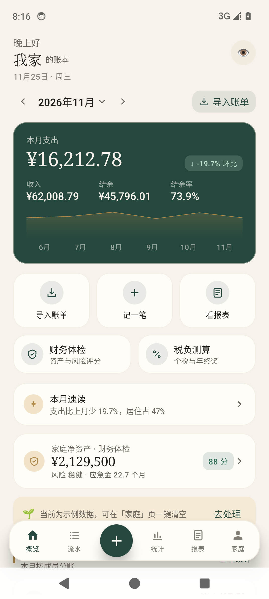 | 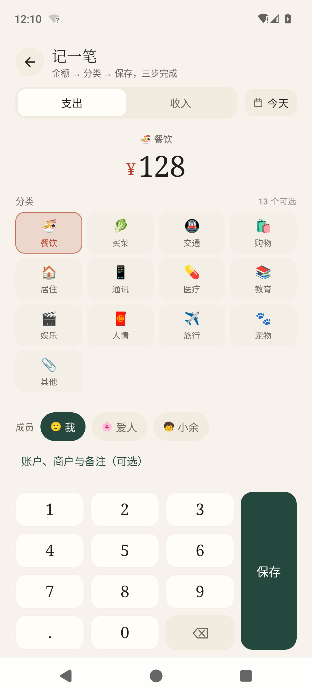 | 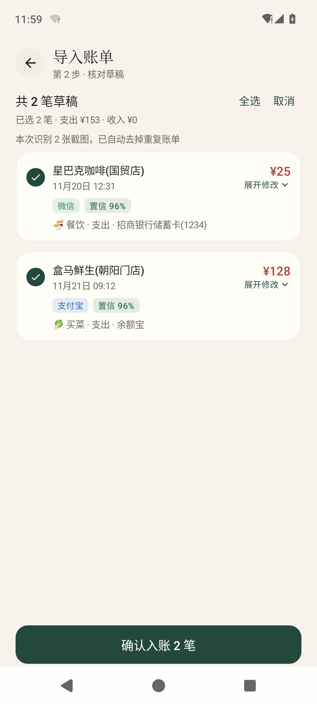 |

| 统计 · 结构 | 统计 · 对比 | 统计 · 日历 |
|---|---|---|
| 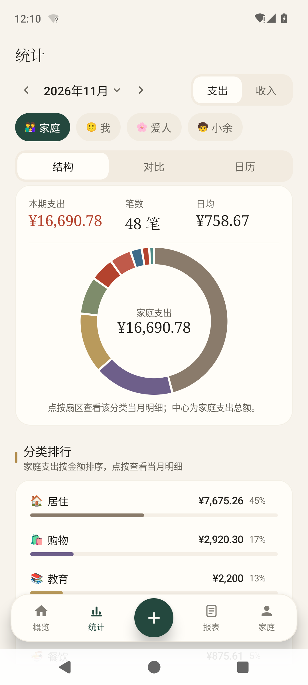 | 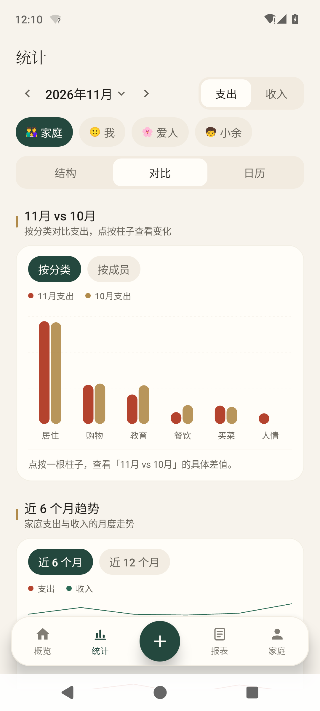 | 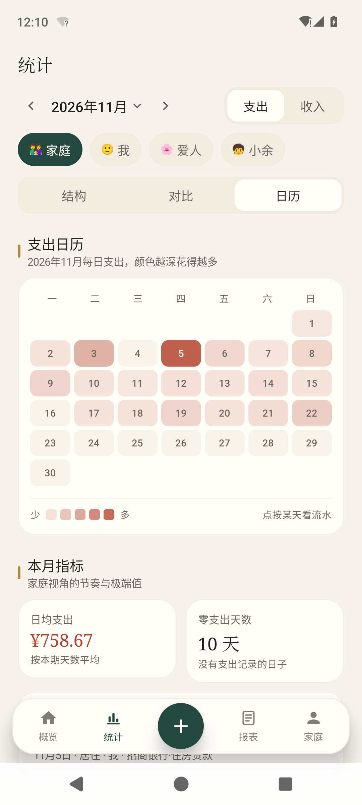 |

| 月度财务报表 | 成员分账 | 自动洞察 |
|---|---|---|
| 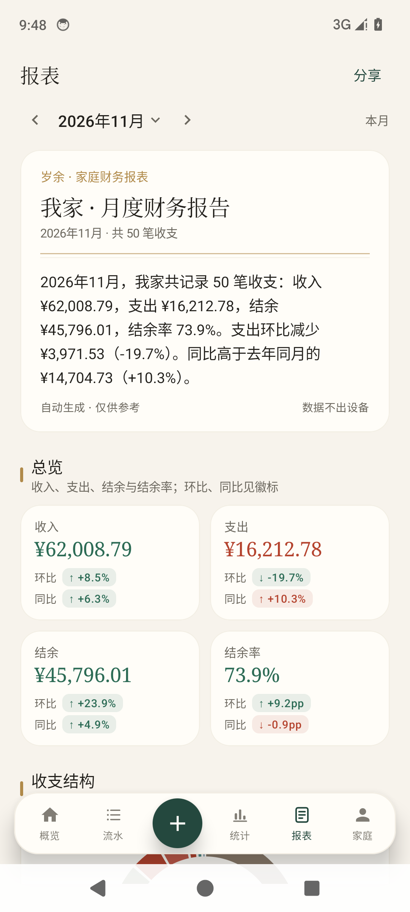 | 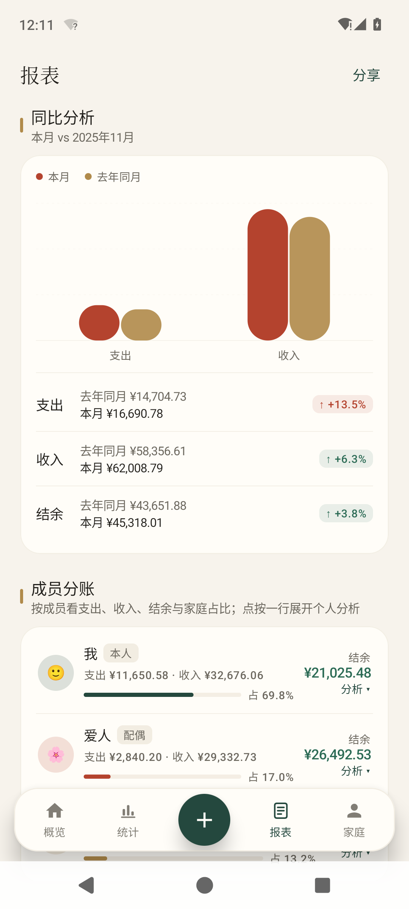 | 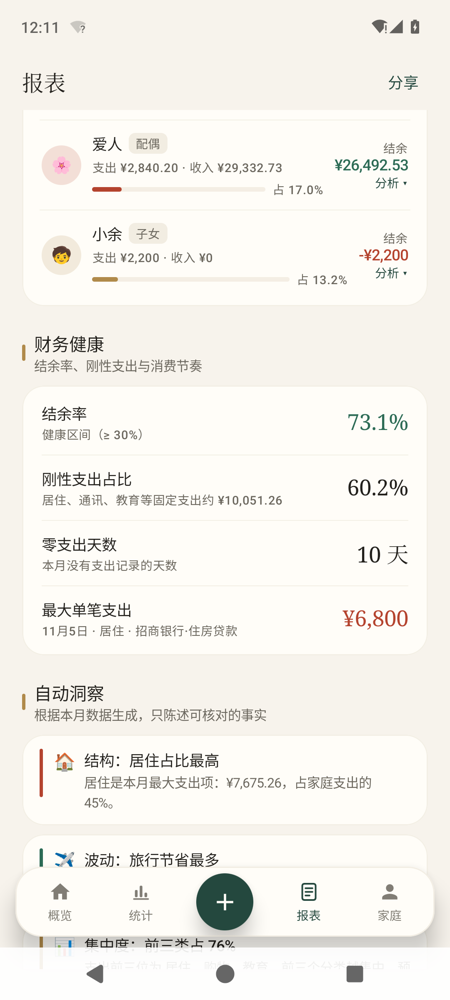 |

| 按日流水 | 长按多选删除 | 流水内编辑 |
|---|---|---|
| 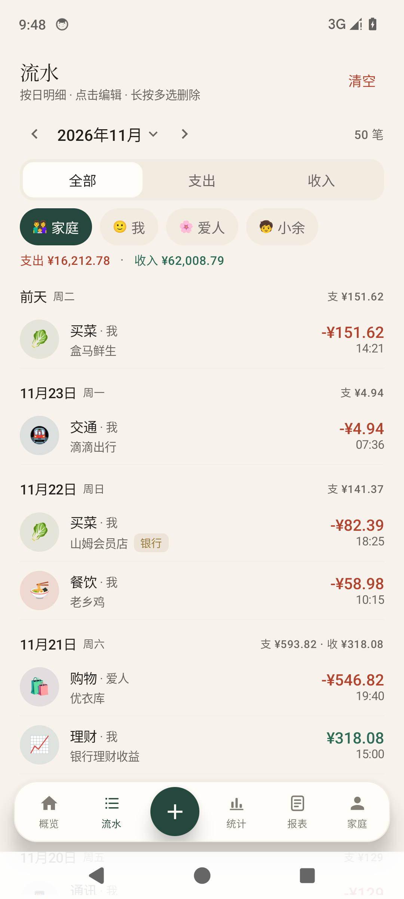 | 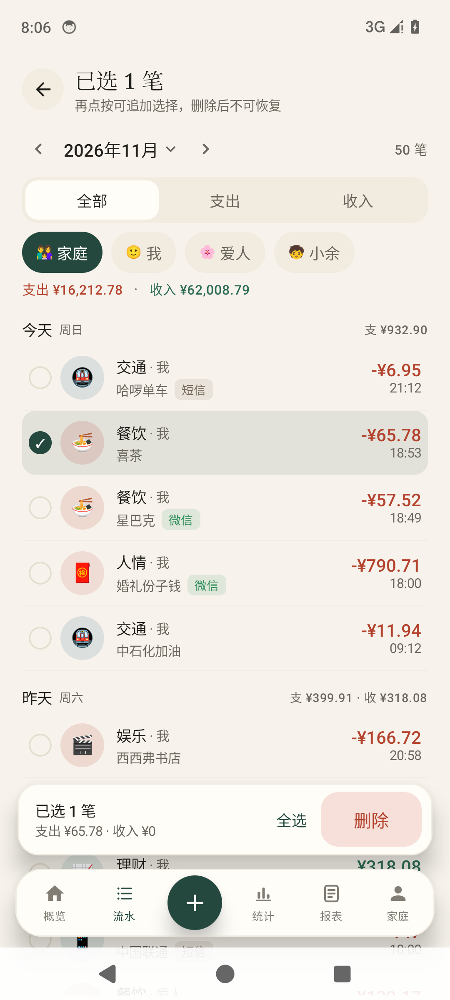 | 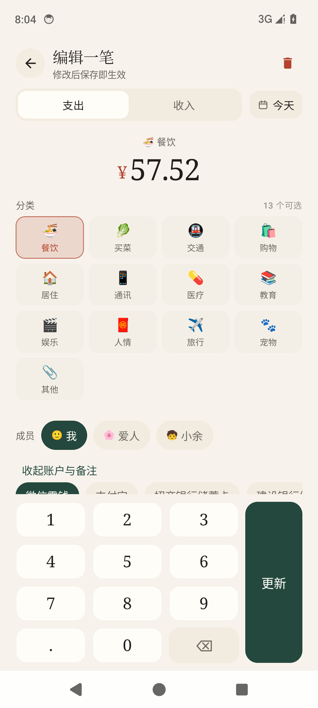 |

| 财务体检总览 | 六维风险雷达 | 资产与负债清单 |
|---|---|---|
| 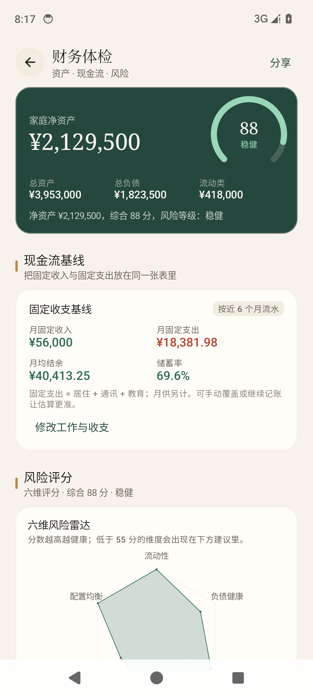 | 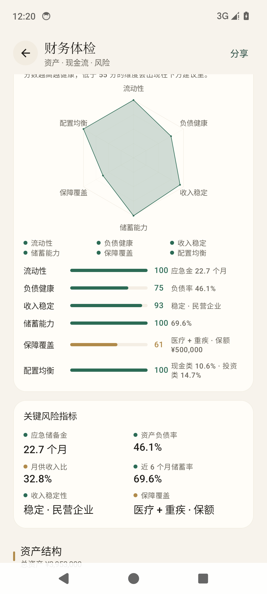 | 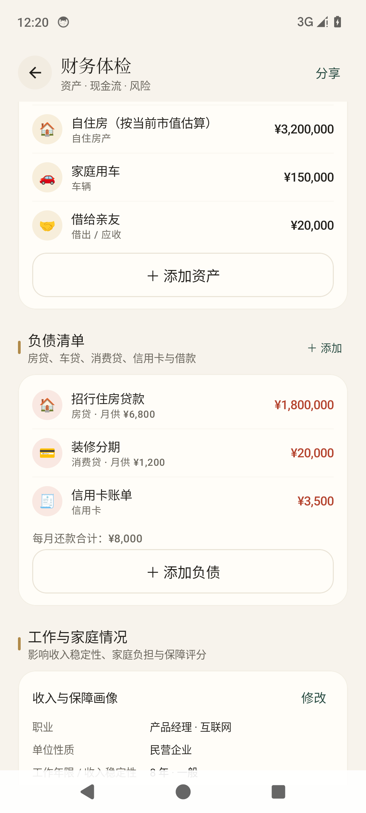 |

## 技术栈与架构

- **Kotlin 2.0.21 + Jetpack Compose（Material3，BOM 2024.09.00）**，单 Activity、单模块；
- **不引入 Room / Hilt / Navigation-Compose / 图表库**：持久化是手写 `org.json` 编解码 + 原子写，
  图表全部为自绘 Canvas，减少依赖与包体，便于审计；
- **纯 Kotlin 计算内核**：`analytics/`、`tax/`、`ocr/` 的解析与计算不依赖 Android，可直接 JVM 单测；
- **端侧 OCR**：ML Kit `text-recognition-chinese`（模型随 APK 打包，可离线），
  按文字坐标重建表格行，解析器处理双列账单、表头与噪声；
- **隐私优先**：Manifest 显式移除 `INTERNET` / `ACCESS_NETWORK_STATE`；
- 金额一律以 `Long` 分存储，避免浮点误差；个税与财务评分都有独立单元测试。

更完整的设计说明见 [`docs/ARCHITECTURE.md`](docs/ARCHITECTURE.md)、
[`docs/产品设计说明.md`](docs/产品设计说明.md)。

## 项目结构

```text
suiyu-ledger/
├── app/
│   ├── build.gradle.kts
│   └── src/
│       ├── main/
│       │   ├── AndroidManifest.xml
│       │   ├── java/com/suiyu/ledger/
│       │   │   ├── MainActivity.kt / SuiyuApp.kt / AppGraph.kt
│       │   │   ├── model/        # 领域模型（流水、成员、分类、资产、负债、画像）
│       │   │   ├── data/         # 仓库、JSON 编解码、内置分类、示例数据
│       │   │   ├── analytics/    # 统计口径、财务体检引擎、自动文案
│       │   │   ├── tax/          # 个税引擎、税率规则、样例与自检
│       │   │   ├── ocr/          # 端侧 OCR、账单解析、样例
│       │   │   ├── ui/           # Compose 主题、组件、首页 / 流水 / 统计 / 报表 / 体检 / 家庭 / 个税 / 导入
│       │   │   ├── nav/          # 单 Activity 内的页面路由
│       │   │   └── util/         # 金额、日期、分享、触感
│       │   └── res/              # 图标、主题、字符串
│       └── test/java/com/suiyu/ledger/   # 76 个 JVM 单元测试
├── docs/                         # 设计文档、规则说明、使用说明、28 张截图
├── tools/gen_promo.py            # 宣传图生成脚本（可选，macOS 字体）
├── gradle/wrapper/               # Gradle 8.9 Wrapper
├── build.gradle.kts / settings.gradle.kts / gradle.properties
├── LICENSE                       # PolyForm Noncommercial 1.0.0
├── NOTICE / THIRD_PARTY_NOTICES.md
├── CONTRIBUTING.md / CODE_OF_CONDUCT.md / SECURITY.md
├── CHANGELOG.md
└── README.md
```

## 快速开始

### 环境要求

| 工具 | 版本 |
|---|---|
| JDK | 17（AGP 8.5.2 要求） |
| Android SDK | Platform 34、Build-Tools 34.0.0 |
| Gradle | 使用仓库自带 Wrapper（Gradle 8.9），无需预装 |
| 操作系统 | macOS / Linux / Windows 均可构建 |

### 构建与测试

```bash
git clone https://github.com/zhao2365177340-cloud/suiyu-ledger.git
cd suiyu-ledger

# Android Studio 打开工程会自动生成 local.properties；
# 命令行构建可手动创建（路径换成你的 SDK 位置）：
echo "sdk.dir=/path/to/Android/Sdk" > local.properties

# 单元测试（76 个，无需模拟器）
./gradlew :app:testDebugUnitTest

# 构建 debug APK
./gradlew :app:assembleDebug
# 产物：app/build/outputs/apk/debug/app-debug.apk
```

Windows 使用 `gradlew.bat`。首次构建会下载 Gradle 与依赖，耗时取决于网络。

### 安装

1. 从 [Releases](https://github.com/zhao2365177340-cloud/suiyu-ledger/releases/latest)
   下载最新 `suiyu-v1.2.1.apk`（约 53 MB）；
2. 传到手机，用文件管理器打开，允许「安装未知来源应用」后安装；
3. 或使用 adb：`adb install -r suiyu-v1.2.1.apk`。

> APK 使用 **debug 签名**（个人项目，未上架应用商店）。覆盖安装需签名一致；
> 从旧版本升级不会清除账本。卸载会删除本机数据，请先用「导出 JSON 备份」留档。

## 使用示例

### 1. 截图导入账单

首页 → 「导入账单」→ 选择 1–9 张微信 / 支付宝 / 银行账单截图 → 等待本机 OCR →
逐条复核金额、分类、成员与日期 → 全选入账。重复记录会自动标注，确认后才写入账本。

### 2. 家庭账本与月报

「家庭」页添加成员（名字、头像 emoji、主题色、身份标签）→ 日常记账时选择成员 →
「报表」页选择账期 → 阅读自动总述、同比环比、成员分账与洞察 → 「分享」生成纯文本月报，
可直接发到家庭群，对方不装 App 也能看懂。

### 3. 整理流水

「流水」Tab → 账期 / 支出收入 / 成员筛选 → 点按一笔编辑；长按进入多选 →
追加选择或全选 → 批量删除；右上角「清空」删除全部流水（保留成员与分类，需二次确认）。

### 4. 财务体检

首页「财务体检」→ 添加资产（存款、理财、房产、车辆等）与负债（房贷、车贷、信用卡等）→
填写工作与家庭情况（可手填固定收支，留空则按近 6 个月流水估算）→
查看净资产、应急金月数、负债率、月供收入比、六维雷达与建议 → 分享体检报告。

### 5. 个税测算

报表页 →「个税测算」→ 填收入、三险一金与七项专项附加扣除 → 查看年度应纳税额、
年终奖两种计税方案对比、12 个月预扣明细 → 生成模拟申报表并分享。

## 测试

```bash
./gradlew :app:testDebugUnitTest
```

当前 **76 个 JVM 单元测试全部通过**（2026-11-25）：

| 测试组 | 数量 | 覆盖 |
|---|---:|---|
| `tax/` | 31 | 累计预扣、年终奖两种方案、专项附加扣除、边界税率 |
| `ocr/` | 21 | 双列账单解析、金额/时间/方向、噪声行、样例自检 |
| `analytics/` | 19 | 统计口径、同比环比、财务体检六维评分与建议 |
| `util/` | 5 | 金额分单位、日期与账期 |

## 数据与隐私

- **不联网**：App 未申请网络权限；OCR、统计、体检、个税计算全部在本机完成；
- **无账号**：不需要注册或登录，数据保存在应用私有目录的 `ledger.json`；
- **可带走**：家庭 → 数据 → 导出 CSV（表格）/ JSON（完整备份）；
- **可隐藏**：金额遮罩一键隐藏敏感数字，适合公共场合；
- **备份提醒**：JSON 为明文，导出后请自行妥善保管。

## 路线图

- [x] v1.0 截图导入 / 统计 / 家庭月报 / 个税测算
- [x] v1.1 流水明细、批量删除、一键清空
- [x] v1.2 财务体检：资产 / 负债 / 工作画像 + 六维风险评分
- [x] v1.2.1 首页与体检页窄屏排版优化
- [ ] v1.3 删除撤销、净资产趋势快照、预算与目标
- [ ] 导入更多银行 / 支付平台模板，提升 OCR 召回率
- [ ] 报表导出为图片长图 / PDF
- [ ] 更多无障碍与国际化（英文界面）

## 已知限制与免责声明

- **debug 签名**，仅适合个人侧载体验，未上架 Google Play / 国内应用商店；
- OCR 识别率依赖截图清晰度与版式，导入后请务必复核草稿；
- 目前仅支持中文界面与人民币账本；
- 财务体检的评分权重与建议是产品化的经验模型，**不构成投资、保险、信贷建议**；
- 个税测算按现行政策口径实现，**仅供参考，最终以税务机关口径为准**；
- 示例数据仅用于演示，正式使用前请清空或替换为自己的真实数据。

## 贡献

欢迎 Issue 与 PR：Bug 报告请附设备 / 系统版本、复现步骤与脱敏截图；功能建议请说明场景。
提交前请先阅读 [CONTRIBUTING.md](CONTRIBUTING.md) 与 [CODE_OF_CONDUCT.md](CODE_OF_CONDUCT.md)。

> 由于项目采用「禁止商用 + 可另行商业授权」的模式，提交 PR 即表示你同意：
> 你的贡献按 PolyForm Noncommercial 1.0.0 授权，并允许维护者将其用于商业授权。
> 详见 [NOTICE](NOTICE)。

## 许可证与商业授权

本项目代码以 **[PolyForm Noncommercial License 1.0.0](LICENSE)** 发布：

- ✅ 允许：个人学习、研究、非商业使用、修改、非商业分发；
- ❌ 禁止：任何商业用途（售卖、付费分发、收费服务、以商业优势为目的的使用等），
  除非另行取得书面商业授权。

> 请注意：由于限制商业使用，这**不是 OSI 定义下的开源许可证**，而是
> 「源码公开（source-available）」的非商业许可。若你只是学习、自用或做非商业项目，
> 可以自由使用；若用于公司内部或商业产品，请先联系作者取得授权。

**名称与品牌**：「岁余」「Suiyu」、App 图标、「日计不足，岁计有余」品牌文案与
`docs/screenshots/` 截图属于作者品牌资产，不在代码许可范围内，未经许可不得用于
修改版分发或暗示作者背书。详见 [NOTICE](NOTICE)。

**商业授权**：请通过 [GitHub @zhao2365177340-cloud](https://github.com/zhao2365177340-cloud)
联系作者，说明用途与规模；具体范围与常见问题见
[`COMMERCIAL_LICENSE.md`](COMMERCIAL_LICENSE.md)。

第三方组件的许可（Compose、ML Kit 等）见 [THIRD_PARTY_NOTICES.md](THIRD_PARTY_NOTICES.md)；
这些组件的许可优先于本项目许可。

## 作者与致谢

- 作者：**luckyzhao**（GitHub: [@zhao2365177340-cloud](https://github.com/zhao2365177340-cloud)）
- 名字与文案取自《庄子·庚桑楚》：「今吾日计之而不足，岁计而有余。」
- 感谢 Jetpack Compose、Kotlin、ML Kit 等开源与端侧 AI 生态。

如果这个项目对你有帮助，欢迎 Star ⭐；发现数据或计算问题时请开 Issue，我会优先核对。

## 文档

| 文档 | 内容 |
|---|---|
| [`docs/ARCHITECTURE.md`](docs/ARCHITECTURE.md) | 架构、数据流、模块职责、关键设计决策 |
| [`docs/产品设计说明.md`](docs/产品设计说明.md) | 产品定位、信息架构、核心流程、设计语言 |
| [`docs/使用说明.md`](docs/使用说明.md) | 从安装到各功能的完整使用手册 |
| [`docs/报表分析规则.md`](docs/报表分析规则.md) | 统计口径、同比环比公式、洞察生成规则 |
| [`docs/账单识别说明.md`](docs/账单识别说明.md) | OCR 与账单解析实现细节、支持版式 |
| [`docs/财务体检与风险评估说明.md`](docs/财务体检与风险评估说明.md) | 资产/负债输入、六维评分公式、建议规则与免责声明 |
| [`docs/个人所得税测算说明.md`](docs/个人所得税测算说明.md) | 个税口径、税率表、年终奖方案与样例 |
| [`docs/市场与产品调研.md`](docs/市场与产品调研.md) | 同类产品调研与差异化取舍 |
| [`docs/命名与品牌.md`](docs/命名与品牌.md) | 名字出处、品牌语气与视觉规范 |
| [`COMMERCIAL_LICENSE.md`](COMMERCIAL_LICENSE.md) | 商业授权范围、申请方式与品牌说明 |
| [`CHANGELOG.md`](CHANGELOG.md) | 版本更新记录 |

---

<div align="center">

**日计不足，岁计有余。**

Made with Kotlin & Jetpack Compose · 本地优先 · 无广告 · 数据不出设备

</div>
